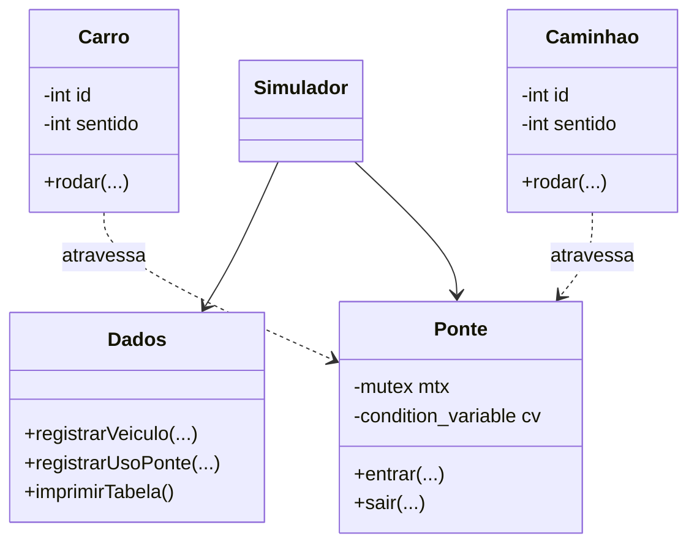

# Arquitetura e Conceitos de Concorrência (C++17)

Este documento acompanha a evolução do projeto, explicando de forma direta as primitivas de concorrência utilizadas e a estrutura de classes implementada.

---

## 1. Primitivas de Concorrência Utilizadas

| Primitiva (`<header>`) | Papel no Projeto | Como funciona na prática |
| :--- | :--- | :--- |
| `std::thread` (`<thread>`) | Linha de execução concorrente | Cada veículo (`Carro` ou `Caminhao`) roda em sua própria thread, simulando chegada, espera na fila e travessia. Exige `.join()` antes do encerramento do `main`. |
| `std::mutex` (`<mutex>`) | Exclusão mútua | Garante que apenas uma thread por vez leia ou altere o estado compartilhado da `Ponte`, de `Dados` ou do terminal (`std::cout`). |
| `std::unique_lock<std::mutex>` (`<mutex>`) | Gerenciador RAII do mutex | Trava o mutex ao ser construído e destrava automaticamente ao sair do escopo. É obrigatório para usar `std::condition_variable`, pois permite liberar e readquirir o lock durante o `wait`. |
| `std::lock_guard<std::mutex>` (`<mutex>`) | Lock simples por escopo | Versão leve (sem `unlock` manual nem `wait`), usada em seções críticas rápidas como logs e registro de métricas em `Dados`. |
| `std::condition_variable` (`<condition_variable>`) | Sincronização por espera condicional | Implementa a fila de espera do **Monitor**: `cv.wait(lock, predicado)` libera o mutex atômicamente e dorme a thread até `notify_all()`, revalidando o predicado ao acordar (evita *spurious wakeups*). |
| `std::chrono::steady_clock` (`<chrono>`) | Medição de tempo monotônico | Mede tempo de espera na fila e tempo total/ocupado da ponte sem sofrer saltos do relógio do sistema. |

### Padrão Monitor
Em C++ não existe a palavra-chave `synchronized` do Java. O **Monitor** é construído encapsulando dentro de uma classe (`Ponte`):
1. O estado compartilhado (direção atual, quantidade na ponte, contadores de fila/lote, último horário de entrada).
2. Um `std::mutex` privado que protege todo acesso ao estado.
3. Uma ou mais `std::condition_variable` para suspender veículos que ainda não podem entrar e acordá-los quando o estado mudar.

---

## 2. Estrutura de Classes (Visão Inicial — será atualizada a cada etapa)

- **`Dados`**: Agrega as métricas por cenário executado durante a sessão do programa (incluindo quantidade de `rodadas` por cenário) e calcula o consolidado `Global`, imprimindo a tabela comparativa (contagens por sentido, espera mín/méd/máx em segundos simulados e % de utilização da Ponte Principal e Ponte Antiga — medida pelo intervalo real em que há pelo menos 1 veículo sobre a ponte, evitando soma duplicada quando há múltiplos carros simultâneos).
- **`Ponte`**: Monitor que controla o acesso concorrente à travessia (direção, capacidade, espaçamento `Ts`, regra de exclusividade para caminhões e alternância sem starvation).
- **`Veiculo` / `Carro` / `Caminhao`**: Entidades executadas por threads com seus tempos (`Ta`, `Tc`/`Tt`) e lógica de requisição de travessia.
- **`Simulador` / `main`**: Lê `--escala <fator>` opcional, executa o menu interativo para seleção dos cenários e consolida os resultados em `Dados`.

### Diagrama de Classes (Esboço Inicial)

